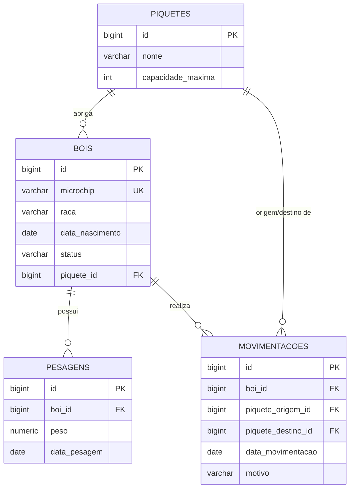

# Modelo de domínio

Documentação das entidades, atributos, relacionamentos, diagrama de entidade-relacionamento e migrations do BoiChip.

## Entidades

### Piquete

Uma área de pasto da fazenda com capacidade máxima delimitada de animais para manejo e rotação.

| Atributo | Tipo Java | Coluna | Obrigatório | Regra |
|---|---|---|---|---|
| `id` | `Long` | `id` | sim | Gerado pelo banco (IDENTITY) |
| `nome` | `String` | `nome` | sim | Não vazio, até 255 caracteres |
| `capacidadeMaxima` | `Integer` | `capacidade_maxima` | sim | Mínimo 1 |

### Boi

Um animal do rebanho, identificado univocamente pelo número do microchip implantado.

| Atributo | Tipo Java | Coluna | Obrigatório | Regra |
|---|---|---|---|---|
| `id` | `Long` | `id` | sim | Gerado pelo banco (IDENTITY) |
| `microchip` | `String` | `microchip` | sim | Único (`UNIQUE`), até 50 caracteres |
| `raca` | `String` | `raca` | sim | Não vazia, até 100 caracteres |
| `dataNascimento` | `LocalDate` | `data_nascimento` | sim | Não pode ser no futuro |
| `status` | `StatusBoi` | `status` | sim | `ATIVO`, `VENDIDO`, `ABATIDO` ou `MORTO` (padrão: `ATIVO`) |
| `piquete` | `Piquete` | `piquete_id` | sim | FK para tabela `piquetes` |

### Pesagem

Registro periódico do peso aferido para acompanhamento do ganho de massa de um animal.

| Atributo | Tipo Java | Coluna | Obrigatório | Regra |
|---|---|---|---|---|
| `id` | `Long` | `id` | sim | Gerado pelo banco (IDENTITY) |
| `boi` | `Boi` | `boi_id` | sim | FK para tabela `bois` |
| `peso` | `BigDecimal` | `peso` | sim | Maior que zero (`NUMERIC(6,2)`) |
| `dataPesagem` | `LocalDate` | `data_pesagem` | sim | Não pode ser no futuro |

### Movimentacao

Registro da troca de piquete/pasto de um animal na fazenda.

| Atributo | Tipo Java | Coluna | Obrigatório | Regra |
|---|---|---|---|---|
| `id` | `Long` | `id` | sim | Gerado pelo banco (IDENTITY) |
| `boi` | `Boi` | `boi_id` | sim | FK para tabela `bois` |
| `piqueteOrigem` | `Piquete` | `piquete_origem_id` | sim | FK para tabela `piquetes` |
| `piqueteDestino` | `Piquete` | `piquete_destino_id` | sim | FK para tabela `piquetes` |
| `dataMovimentacao` | `LocalDate` | `data_movimentacao` | sim | Não pode ser no futuro |
| `motivo` | `String` | `motivo` | sim | Até 255 caracteres |

## Relacionamentos

| De | Para | Tipo | No banco | No código |
|---|---|---|---|---|
| Boi | Piquete | muitos para um | `bois.piquete_id` referencia `piquetes(id)` | `@ManyToOne` em `Boi` |
| Pesagem | Boi | muitos para um | `pesagens.boi_id` referencia `bois(id)` | `@ManyToOne` em `Pesagem` |
| Movimentacao | Boi | muitos para um | `movimentacoes.boi_id` referencia `bois(id)` | `@ManyToOne` em `Movimentacao` |
| Movimentacao | Piquete (Origem) | muitos para um | `movimentacoes.piquete_origem_id` referencia `piquetes(id)` | `@ManyToOne` em `Movimentacao` |
| Movimentacao | Piquete (Destino) | muitos para um | `movimentacoes.piquete_destino_id` referencia `piquetes(id)` | `@ManyToOne` em `Movimentacao` |

## Diagrama ER

## Migrations

| Versão | Arquivo | O que cria |
|---|---|---|
| V1 | `V1__criar_piquetes.sql` | Tabela `piquetes` |
| V2 | `V2__criar_bois.sql` | Tabela `bois` com chave estrangeira para `piquetes` e microchip `UNIQUE` |
| V3 | `V3__criar_pesagens.sql` | Tabela `pesagens` com chave estrangeira para `bois` |
| V4 | `V4__criar_movimentacoes.sql` | Tabela `movimentacoes` com chaves para `bois` e `piquetes` (origem e destino) |
